<a href="https://pachara.app">
  <picture>
    <source media="(prefers-color-scheme: dark)" srcset="https://raw.githubusercontent.com/pachara-n/pachara-n/main/assets/profile/ide-hero-dark.svg" />
    
  </picture>
</a>

<!--  

`↗` **[pachara.app](https://pachara.app)** &nbsp;&nbsp;·&nbsp;&nbsp; `in` **[LinkedIn](https://www.linkedin.com/in/pachara-nokroy)** &nbsp;&nbsp;·&nbsp;&nbsp; `@` **[Email](mailto:pacharanokroy2003@gmail.com)** -->

### `projects.ts`

<table>
<tr>
<td valign="top" width="48%">

#### Open Source

- **[`skills-lint`](https://github.com/pachara-n/skills-lint)**  
  CLI &amp; GitHub Action validating AI agent `SKILL.md` folders for missing files, broken frontmatter, and duplicates.  
  `TypeScript` `CLI` `GitHub Action`

- **[`bombgrid`](https://github.com/pachara-n/bombgrid)**  
  GitHub Action that turns your contribution graph into an animated Bomberman SVG (running live below).  
  `TypeScript` `SVG` `GitHub Action`

</td>
<td valign="top" width="52%">

#### Production Systems &nbsp;·&nbsp; [`pachara.app ↗`](https://pachara.app)

- **Faculty Room Booking** — Web platform with ThaID auth &amp; analytics (`Next.js` `NestJS` `PostgreSQL`)
- **Messenger CRM Aggregator** — Meta Graph API webhooks &amp; real-time chat (`Next.js` `NestJS` `WebSockets`)
- **Email-to-Drive Archiver** — Automated Google Workspace archiving &amp; LINE alerts (`NestJS` `Docker`)
- **LINE LIFF Platform** — CMS-driven business pages (`Nuxt` `Strapi` `Supabase`)

</td>
</tr>
</table>

 

 

### `stack.json`

  

  
  
  
  <picture>
    <source media="(prefers-color-scheme: dark)" srcset="https://raw.githubusercontent.com/pachara-n/pachara-n/main/assets/ai-tools/cursor-white.svg" />
    
  </picture>
  

 

### `bombgrid.svg`

<picture>
  <source media="(prefers-color-scheme: dark)" srcset="https://raw.githubusercontent.com/pachara-n/pachara-n/output/bombgrid-dark.svg" />
  <source media="(prefers-color-scheme: light)" srcset="https://raw.githubusercontent.com/pachara-n/pachara-n/output/bombgrid.svg" />
  
</picture>

 

<picture>
  <source media="(prefers-color-scheme: dark)" srcset="https://raw.githubusercontent.com/pachara-n/pachara-n/main/assets/profile/footer-wave-dark.svg" />
  
</picture>
